# TMJ Diagnosis / Joint Monitor System - Architecture Documentation

## 1. SYSTEM ARCHITECTURE BLOCK DIAGRAM

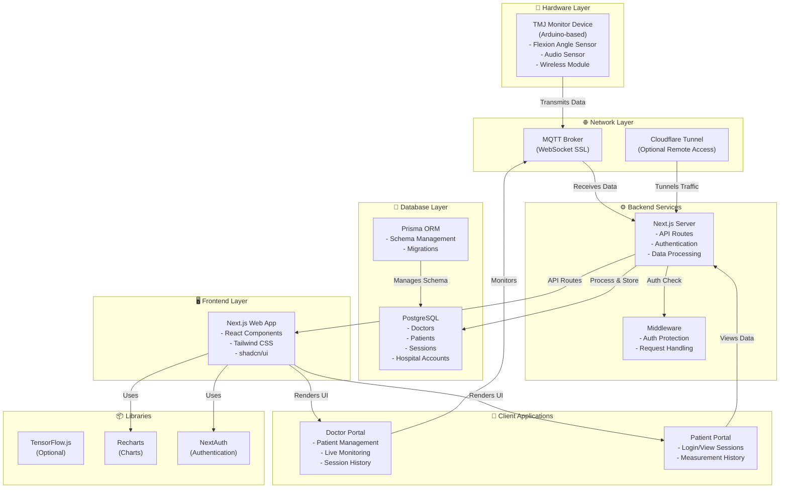

---

## 2. DATA FLOW DIAGRAM

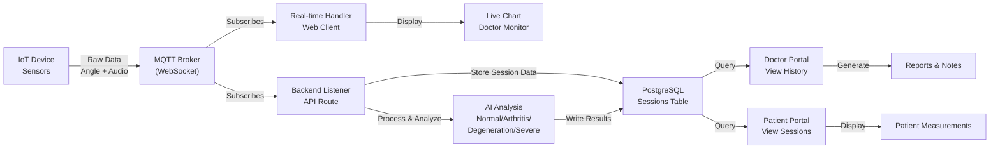

---

## 3. USER AUTHENTICATION FLOW

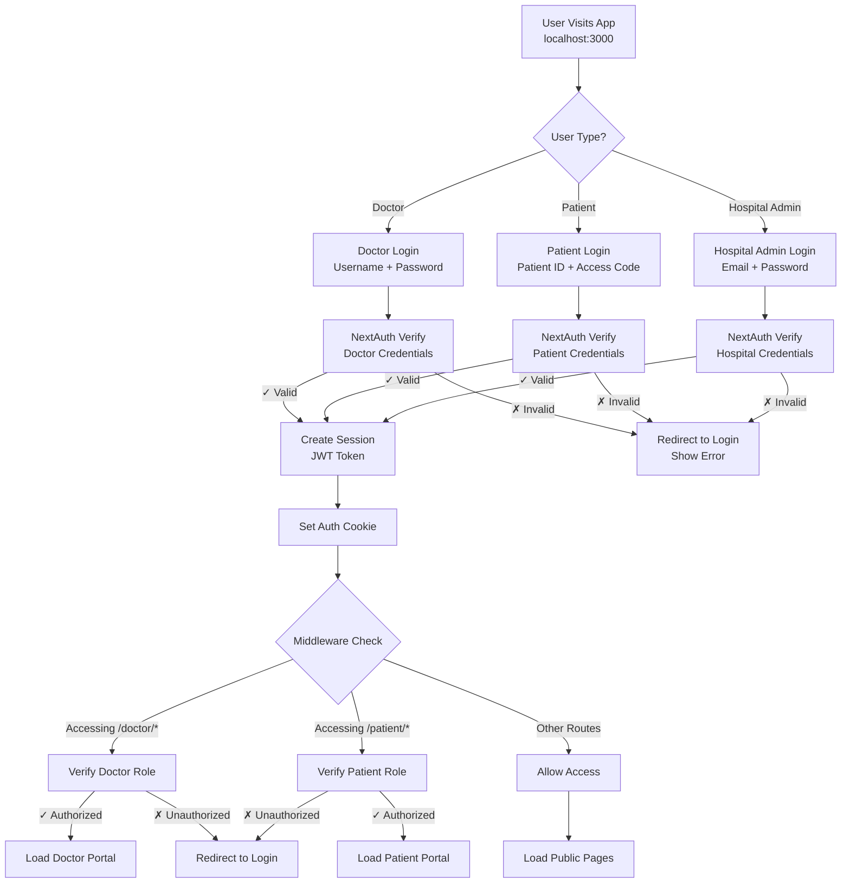

---

## 4. DOCTOR WORKFLOW FLOWCHART

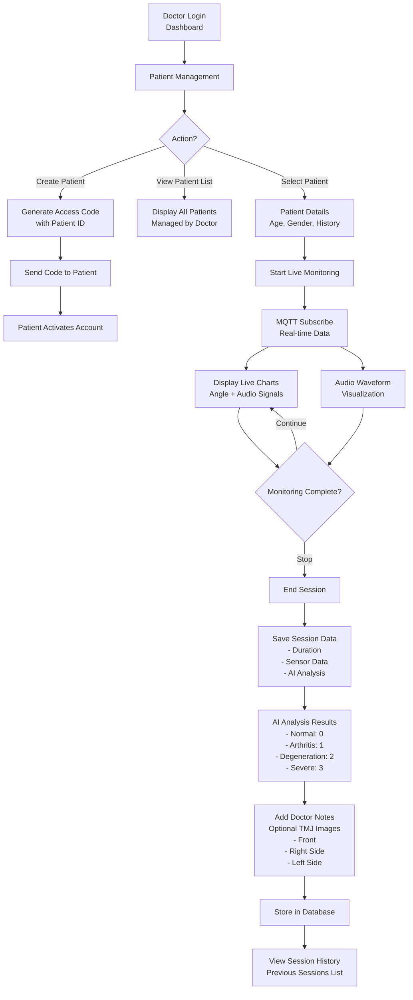

---

## 5. PATIENT WORKFLOW FLOWCHART

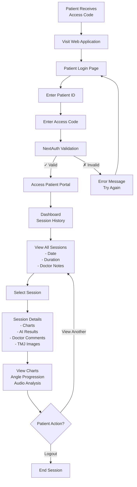

---

## 6. DATABASE SCHEMA DIAGRAM

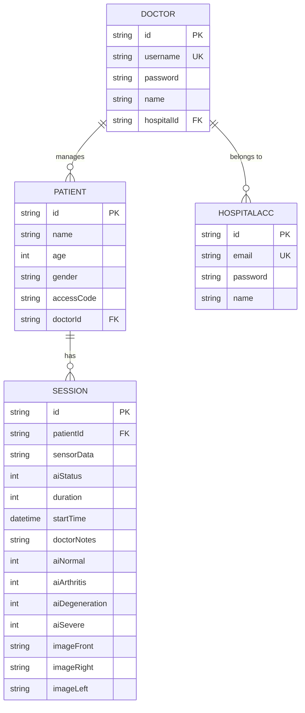

---

## 7. API ENDPOINT ARCHITECTURE

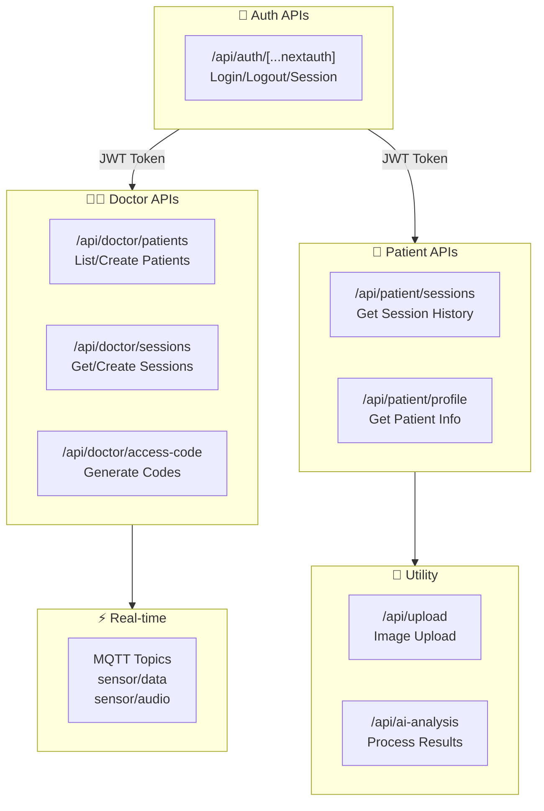

---

## 8. REAL-TIME DATA FLOW WITH MQTT

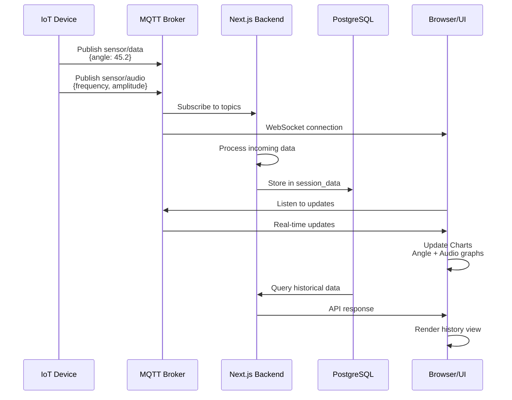

---

## 9. COMPLETE SYSTEM INTERACTION FLOW

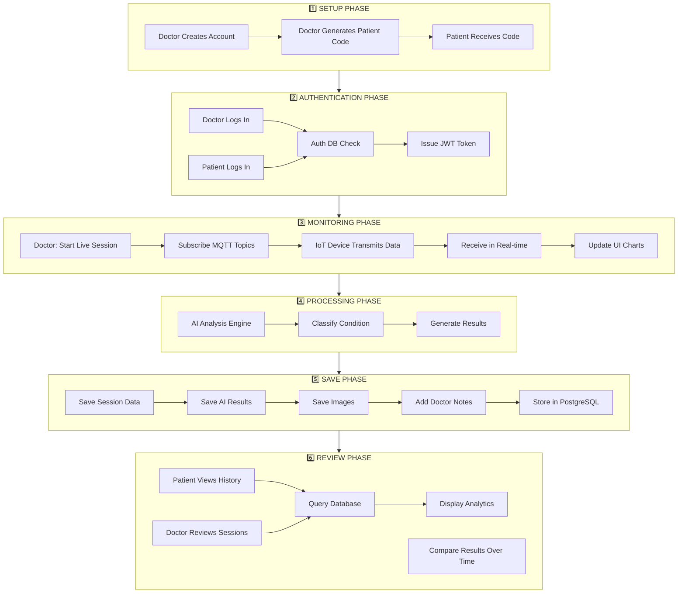

---

## 10. DEPLOYMENT & INFRASTRUCTURE

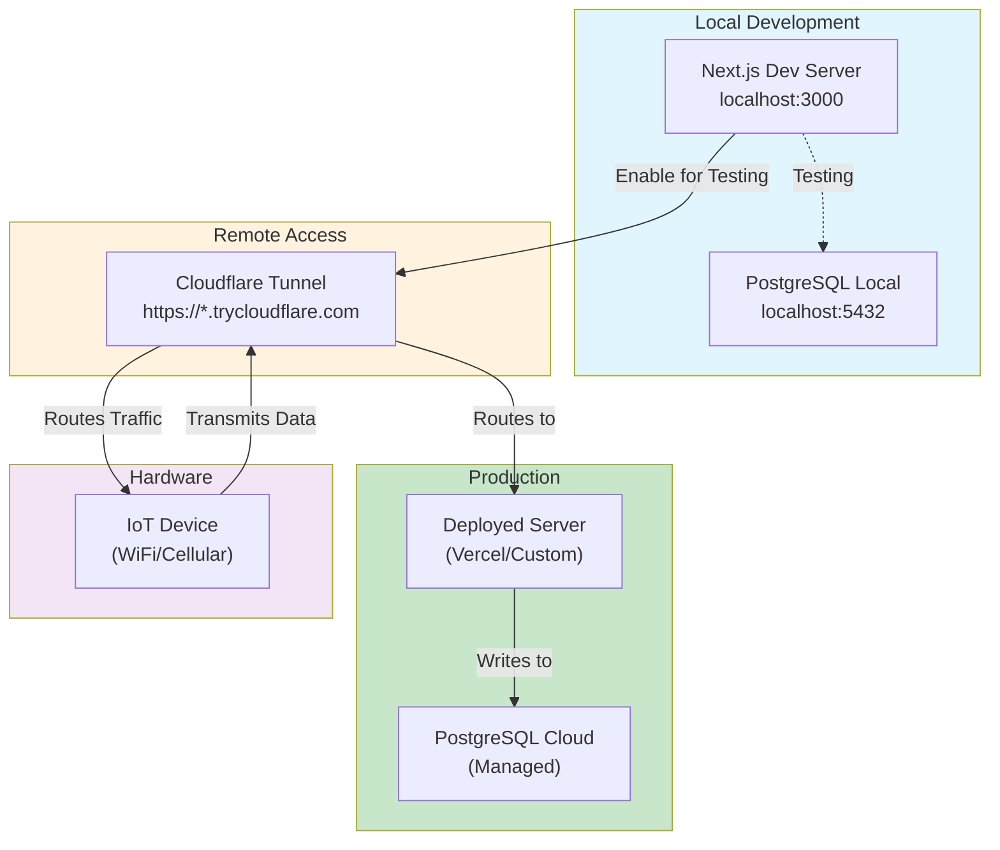

---

## 11. STATE MANAGEMENT & DATA FLOW

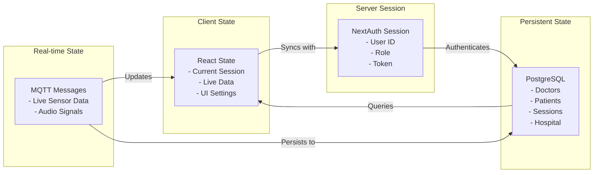

---

## 12. ERROR HANDLING & RECOVERY

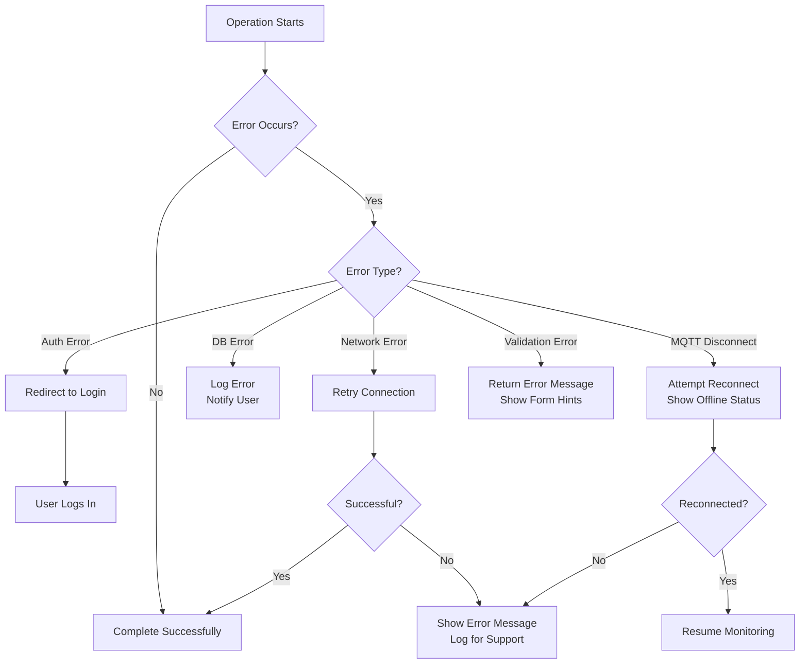

---

## Summary

This TMJ Diagnosis System consists of:

1. **Hardware**: Arduino-based IoT device measuring jaw flexion angle & audio signals
2. **Network**: MQTT over WebSocket for real-time data transmission
3. **Backend**: Next.js with API routes for business logic
4. **Database**: PostgreSQL storing doctors, patients, sessions, and AI analysis results
5. **Frontend**: React components with real-time chart visualization
6. **Authentication**: NextAuth with role-based access control
7. **Analytics**: AI classification of TMJ conditions (Normal/Arthritis/Degeneration/Severe)
8. **Portals**: Separate Doctor and Patient interfaces with different permissions
