# TMJ System - Detailed Technical Architecture

## 13. MODULE & COMPONENT HIERARCHY

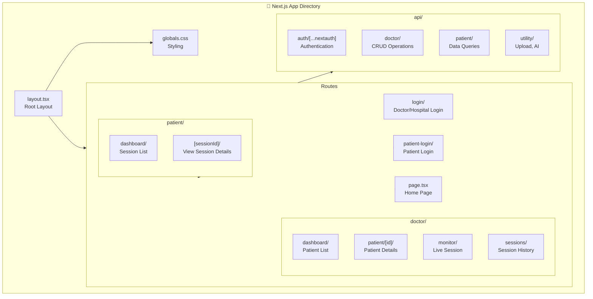

---

## 14. COMPONENT TREE - DOCTOR PORTAL

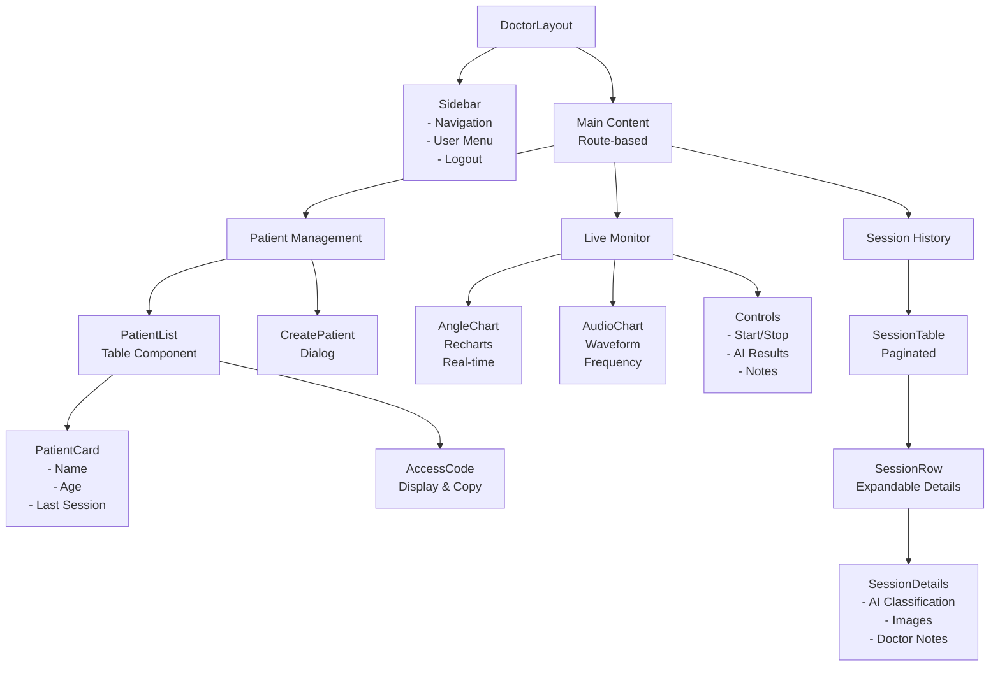

---

## 15. COMPONENT TREE - PATIENT PORTAL

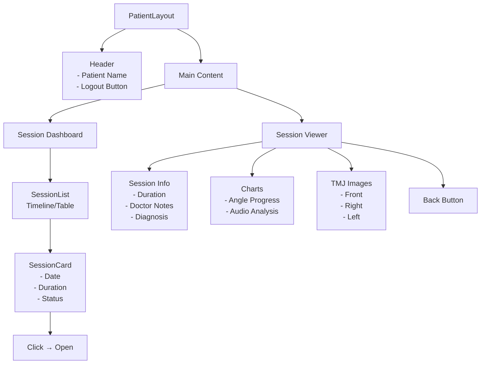

---

## 16. PRISMA ORM OPERATIONS

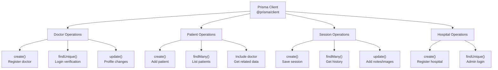

---

## 17. NEXTAUTH AUTHENTICATION FLOW

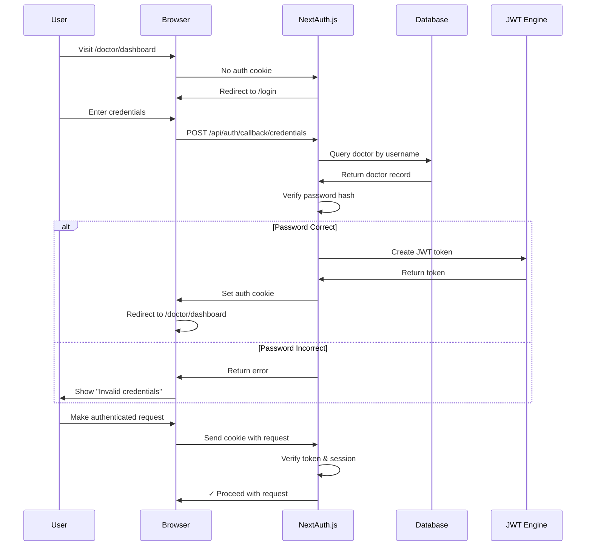

---

## 18. MQTT REAL-TIME COMMUNICATION

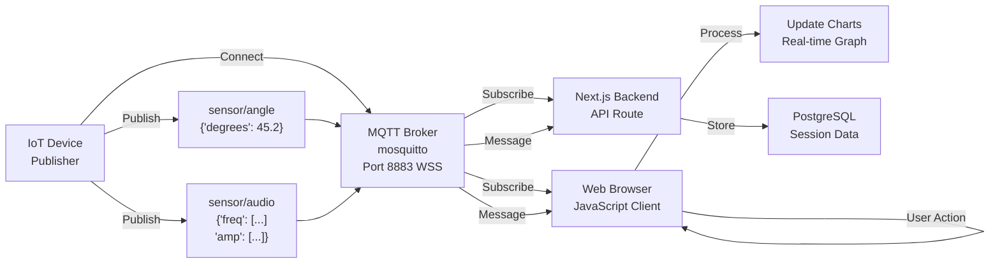

---

## 19. DATA PERSISTENCE FLOW

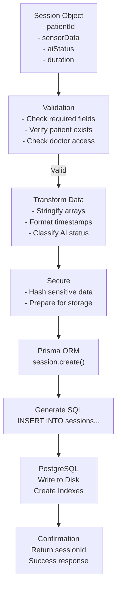

---

## 20. AI ANALYSIS PIPELINE

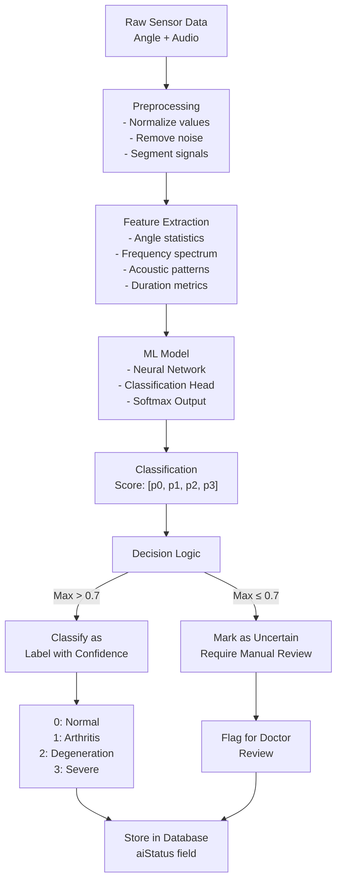

---

## 21. IMAGE UPLOAD & STORAGE

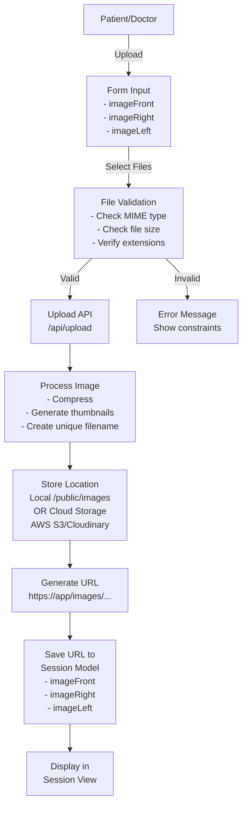

---

## 22. SECURITY LAYERS

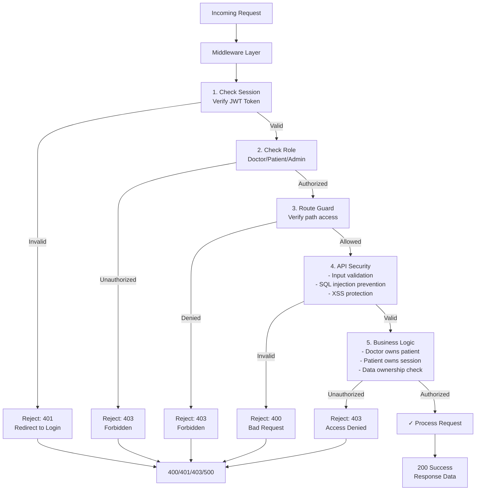

---

## 23. ERROR HANDLING HIERARCHY

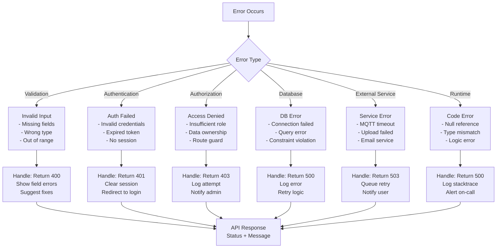

---

## 24. DEPLOYMENT & CI/CD PIPELINE

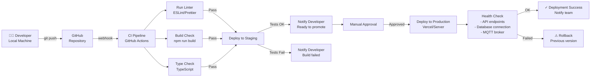

---

## 25. MONITORING & OBSERVABILITY

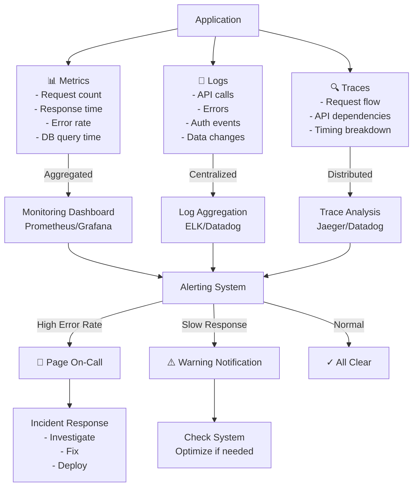

---

## 26. BACKUP & DISASTER RECOVERY

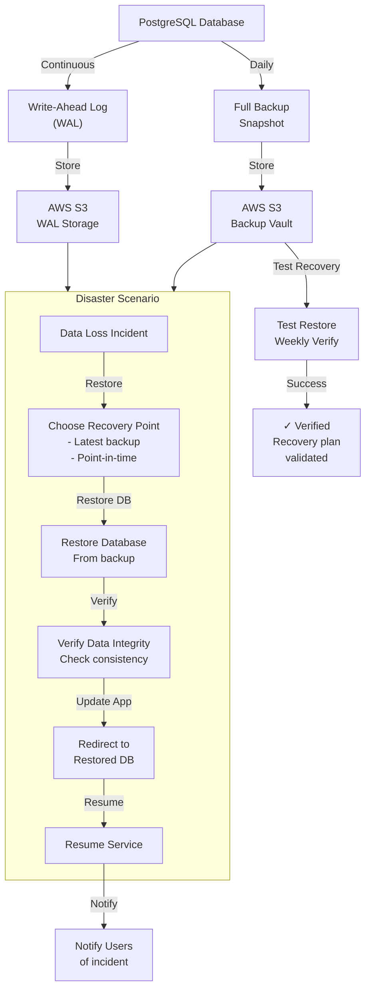

This complete technical architecture documentation provides a comprehensive view of all system components, data flows, and operational procedures for the TMJ Diagnosis System.
